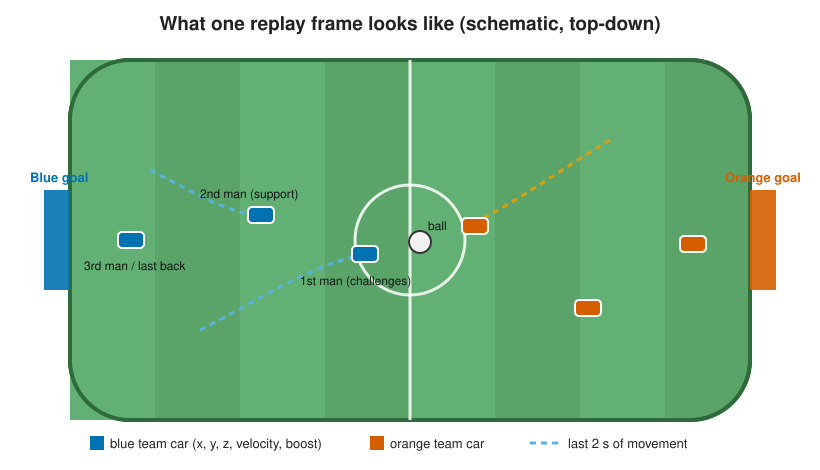
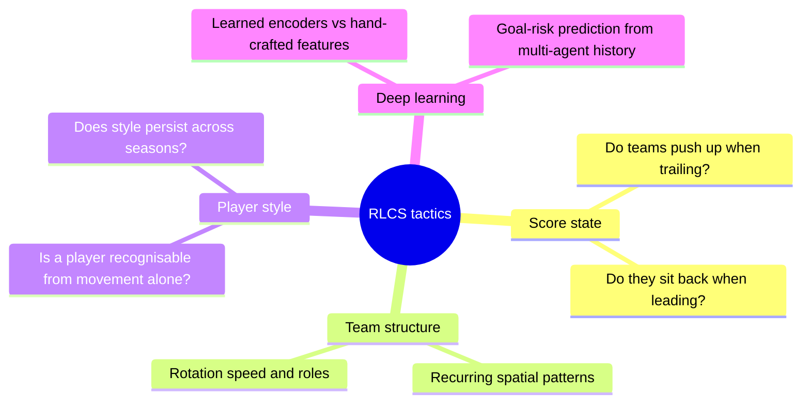
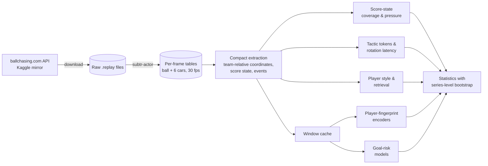
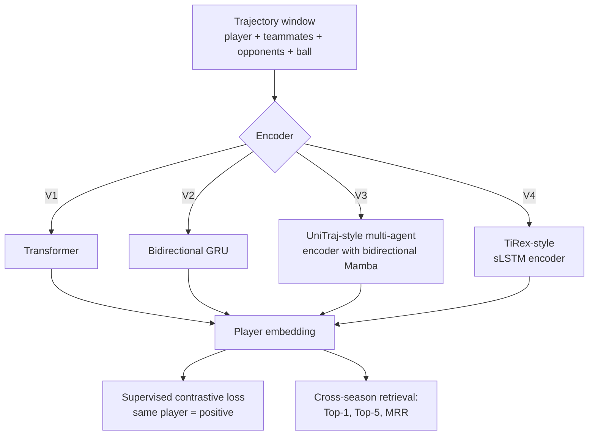

# Tactics in Professional Rocket League

**How do the best Rocket League teams in the world actually play?**
This repository turns five seasons of official *Rocket League Championship Series* (RLCS) replays into
frame-by-frame trajectories, and uses them to study team rotation, how teams react to the score, and
whether individual professional players leave a recognisable "movement fingerprint".

<p align="center"></p>

---

## Contents

- [The game in 30 seconds](#the-game-in-30-seconds)
- [Research questions](#research-questions)
- [Data](#data)
- [How the pipeline works](#how-the-pipeline-works)
- [Deep-learning models](#deep-learning-models)
- [Repository layout](#repository-layout)
- [Getting started](#getting-started)
- [Principles](#principles)
- [Licence and citation](#licence-and-citation)

## The game in 30 seconds

Rocket League is "football with rocket-powered cars". Two teams of three cars try to knock an oversized
ball into the opposing goal within five minutes; ties go to sudden-death overtime. Cars can drive on
walls, jump and fly using **boost**, a resource collected from pads on the field.

Good teams **rotate**: at any moment one player challenges the ball (*1st man*), one supports
(*2nd man*) and one stays back (*3rd man*), and they cycle through these roles continuously.
Every professional game is saved as a replay file, which records the position and velocity of all six
cars and the ball many times per second. That makes the professional scene an unusually complete,
public record of team behaviour.

The project started purely out of curiosity about the game.

## Research questions



| # | Question | Main tools |
|---|---|---|
| 1 | **Score state.** Does positioning and pressure change when a team is leading, tied or trailing, especially late in a game? | Geometric coverage metrics, dependence-aware bootstrap |
| 2 | **Structure.** Which recurring spatial patterns ("tactic tokens") describe team play, and how fast do teams rotate? | Clustering, semi-Markov sequence models |
| 3 | **Player style.** Can a player be retrieved from an unlabelled game in a later season, from trajectories only? | Hand-crafted style features, cross-season retrieval |
| 4 | **Deep learning.** Do learned trajectory encoders beat hand-crafted features? Can a model estimate goal risk from the last few seconds? | Contrastive player encoders, multi-agent sequence models |

All findings are reported as associations in observational data, with confidence intervals.
Score colours used throughout the project: <span>leading</span> blue `#0072B2`, tied green `#009E73`, trailing orange `#D55E00`.

## Data

| Season | Parsed games | Frames (30 fps) | 3v3 games |
|---|---:|---:|---:|
| RLCS 2021-22 | 11,699 | 139.9 M | 11,671 |
| RLCS 2022-23 | 15,410 | 184.3 M | 15,397 |
| RLCS 2024 | 7,307 | 87.5 M | 7,301 |
| RLCS 2025 | 7,081 | 85.1 M | 6,320 |
| RLCS 2026 | 7,762 | 94.3 M | 6,104 |
| **Total** | **49,259** | **591.2 M** | **46,793** |

**Sources.** The public Kaggle mirror `rolvarild/rocket-league-championship-series-replays` and the official
RLCS replay groups on [ballchasing.com](https://ballchasing.com). Replays are parsed with
[subtr-actor](https://github.com/rlrml/subtr-actor).

**Not included.** Raw replays and frame data (about 210 GB) are not part of this repository; the scripts
below re-create them. The Kaggle data carry no licence statement, so use them for research only, do not
redistribute the raw files, and cite the dataset and ballchasing.com.

**Splits.** Seasons are split chronologically. Earlier seasons are used for development and validation,
and the most recent season (RLCS 2026) is held out as a final test set that analysis code does not open
during development.

## How the pipeline works



1. **Download** (`scripts/download_kaggle.sh`, `scripts/ballchasing.py`): fetch replays and their metadata (teams, event, stage, date).
2. **Parse** (`scripts/parse_replays.py`): convert each replay into per-frame ball and player state; failures are logged, not silently dropped.
3. **Extract** (`tactics/src/tactics_code/extract.py`, `data.py`): mirror every frame into the focal team's attacking direction and store compact arrays.
4. **Analyse** (`tactics/src/tactics_code/`): one module per question (see the layout table).
5. **Infer** (`stats.py`): games inside the same series are not independent, so uncertainty is estimated by resampling whole series.

## Deep-learning models



- `tactics/src/pilot_encoder/`: a small, fixed comparison of four encoder families for player fingerprints, all trained from scratch with an identity-balanced supervised-contrastive objective.
- `tactics/src/ai_experiments/`: follow-up experiments: a shared window cache, fingerprint encoders, linear/MLP baselines on hand-crafted summaries, and goal-risk models that compare a six-second multi-agent history against single-snapshot inputs.

Every learned model is compared against hand-crafted baselines on the same retrieval benchmark.

## Repository layout

```
.
├── scripts/                  download and parse replays
├── docs/DATA_PIPELINE.md     detailed data notes (folder layout, metadata fields)
├── tactics/
│   ├── src/
│   │   ├── tactics_code/     extraction, score-state, tokens, style, statistics
│   │   ├── pilot_encoder/    player-encoder comparison (V1–V4) + tests
│   │   ├── ai_experiments/   fingerprint and goal-risk deep-learning experiments
│   │   └── tests/            unit tests on synthetic data
│   ├── scripts/              case-study extraction
│   ├── tools/                small utilities
│   └── tests/
├── env.sh / setup_env.sh     environment
└── requirements.txt
```

| Module | What it does |
|---|---|
| `tactics_code/extract.py` | Team-relative compact arrays, no invented parser semantics |
| `tactics_code/pressure.py` | Geometric cover of the own goal and the late-game score interaction |
| `tactics_code/rotation_latency.py` | How long a team takes to restore a back player |
| `tactics_code/kickoff.py` | Kickoff choices and their associations |
| `tactics_code/tokens.py` | Temporal "tactic token" vocabulary and sequence grammar |
| `tactics_code/style.py`, `style_retrieval.py` | Player style persistence and cross-season retrieval |
| `tactics_code/stats.py` | Dependence-aware bootstrap and multiple-testing helpers |
| `pilot_encoder/models*.py` | The four encoder families |
| `ai_experiments/riskrun.py` | Goal-risk models from multi-agent history |

## Getting started

Requirements: Python 3.11, a Linux machine with enough disk for the frames (about 130 GB at 30 fps),
and a CUDA GPU for the deep-learning experiments.

```bash
git clone https://github.com/ChuangqiLee/rlcs-replays.git
cd rlcs-replays
bash setup_env.sh                        # create .venv
source env.sh                            # activate it in every new shell
echo "BALLCHASING_API_KEY=..." > .env    # your own key; .env is git-ignored

bash scripts/download_kaggle.sh          # RLCS 2021-22 to 2024 from Kaggle
python scripts/ballchasing.py            # newer seasons and missing replays
python scripts/parse_replays.py          # per-frame tables

python -m pytest tactics/src/tests       # unit tests on synthetic data
```

## Principles

- **No made-up numbers.** Every reported number is computed by code from the raw replays.
- **Associations, not causes.** Players choose their positions, so results are described as associations.
- **Pre-declared analyses.** Main tests are fixed before results are seen; post-hoc checks are labelled as such.
- **Negative results are kept.** Analyses that did not hold up are reported as robustness or boundary results, not hidden.
- **The test season stays closed** until the final evaluation.

## Licence and citation

The code is shared for research use. Replay data belong to their original sources; please cite the
Kaggle RLCS replay dataset, ballchasing.com and subtr-actor if you use them. A paper describing this
work is in preparation; until then, please cite this repository.
